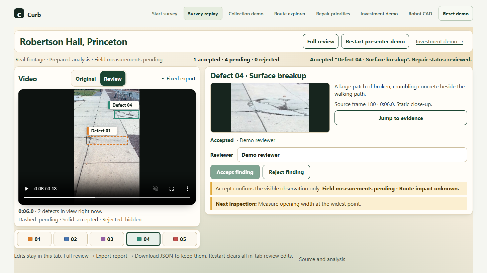
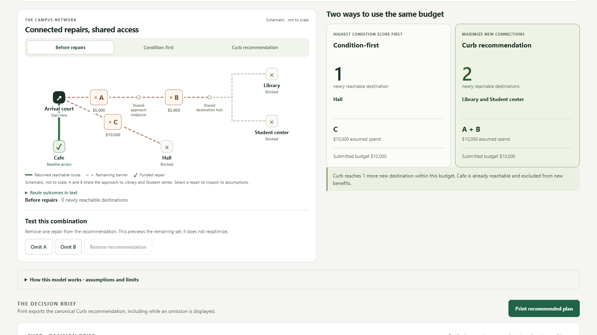
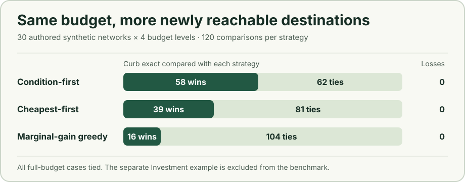

# Curb

**Which sidewalk repairs reconnect the most destinations on a fixed budget?**

Curb helps campus facilities teams review sidewalk evidence, compare repair combinations, and bring a funding recommendation to a budget meeting.

[**Start the live demo**](https://curb-taupe.vercel.app/curb/surveys/robertson-hall?present=1) · [Investment demo](https://curb-taupe.vercel.app/curb/investment-demo) · [Route Explorer](https://curb-taupe.vercel.app/curb/explore) · [Three-minute judge walkthrough](docs/demo/INVESTMENT_DEMO_SCRIPT.md)

## From evidence to a decision

1. **Review a real finding.** In the [Robertson Hall footage](https://curb-taupe.vercel.app/curb/surveys/robertson-hall?present=1), switch from **Original** to **Review**. Open **Defect 04 · Surface breakup** and use **Jump to evidence** to see the original frame and close-up. Accepting the finding records a named visual review. Field measurements and route impact remain unknown.

   

2. **Compare two plans at the same budget.** In the separate [synthetic Investment demo](https://curb-taupe.vercel.app/curb/investment-demo), set **$10,000**. Condition-first funds C and makes Hall newly reachable. Curb funds A+B and makes Library and Student center newly reachable, for the same assumed spend. Cafe already has access.

   

3. **Test the dependency and print the recommendation.** Choose **Omit A** or **Omit B**. Either omission leaves both shared destinations blocked. Restore the recommendation and print the decision brief. At **$20,000**, both plans make the same three destinations newly reachable.

## What the benchmark shows

An independent rerun checked **30 authored synthetic networks at four budget levels each**. At the same assumed budget, Curb’s exact planner made **0.81 more destinations newly reachable on average** than condition-first. It led in **58 of 120** paired cases and tied in the other **62**.

The chart counts paired budget cases. Each win means more modeled destinations became reachable at the same assumed budget. The separately authored Investment example is outside the benchmark. In that $10,000 example, cheapest-first also chooses A+B. [Methods and results](docs/evaluation/METRICS_RESULTS.md) · [Approved claims](docs/evaluation/METRICS_CLAIMS.md) · [Raw evidence and independent rerun](docs/evidence/README.md)

## What a real repair decision still needs

The [Cañada College case](https://curb-taupe.vercel.app/curb/case-studies/canada-college) investigates a published 2020 accessibility audit. Its independently reviewed inventory contains 69 records, including source context and summaries. Four proposed ramp assemblies total **$23,500 in historical estimates**. The source leaves crossing connections, endpoint approaches and complete repair scope unresolved, so Curb shows the missing evidence before offering a route comparison. [Case findings and proof](reports/curb/canada-2020/readiness.md)

A separate [map-based conditional study](reports/curb/canada-map-study/README.md) tests those historical ramp costs on the public campus map. It shows conservative results, explicit assumptions, repair dependencies, and equal-budget comparisons—including ties with both greedy strategies. Its favorable scenarios assume other needed access work is addressed outside the ramp budget; they are not observed repair outcomes.

The footage documents visible conditions. Facilities staff would still walk the route with disabled campus users, measure the conditions and repair scope, and obtain current quotes. The synthetic plans do not establish real-world access, construction outcomes, or ADA compliance.

[Run Curb locally](docs/DEVELOPMENT.md) · [Documentation](docs/README.md) · [Media and chart sources](docs/assets/judges/ASSETS.md) · [License](LICENSE) · [Third-party notices](THIRD_PARTY_NOTICES.md)
