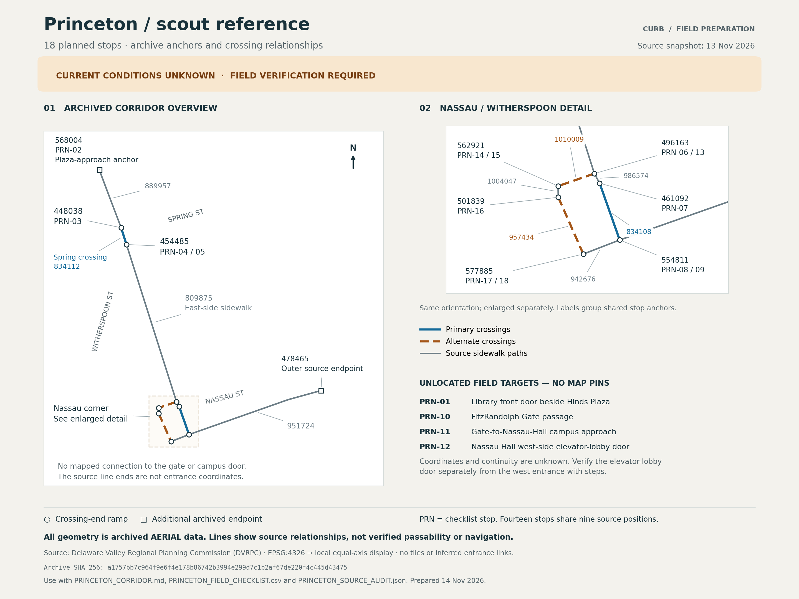

# Princeton scout map

**All current conditions are unknown. This is an archival scouting reference, not navigation or a verified accessible route.** Use it with the corrected [corridor packet](PRINCETON_CORRIDOR.md), [18-stop checklist](PRINCETON_FIELD_CHECKLIST.csv) and [source audit](PRINCETON_SOURCE_AUDIT.json) at base `2d56e6a0a2ca4e70fd2977009d572e983182fb4c`.

[Open the vector SVG](PRINCETON_SCOUT_MAP.svg) · [Open the full-resolution PNG](PRINCETON_SCOUT_MAP.png)



Prepared 2026-11-14 for [PRINCETON-SCOUT-MAP/1](https://github.com/vzhu08/Curb/issues/1#issuecomment-6876823930). The figure adds a geographic reference to the existing packet. It records no visit, observation, surveyed route, new entrance position, walking time or measured distance.

## Reading the figure

The left panel shows the complete selected archive geometry from the plaza-approach endpoint, across Spring and down east Witherspoon to Nassau. The right panel enlarges the Nassau crossing ends and two small corner connectors. Both panels point north upward and preserve local geographic proportions; they have different display scales. The dashed rectangle is an inset locator, not a physical boundary.

Blue solid lines identify the proposed primary crossing choices. Brown dashed lines identify the nearby alternate crossing choices. Gray lines are the six selected source sidewalk paths. These colors distinguish scout choices, not safe, passable, repaired or inspected conditions. Thin leaders connect labels to features; they are annotations, not extra paths.

Circles identify the eight selected crossing-end ramp records. Squares identify two additional outer endpoints verified against all 83 archived ramp points. Neither shape represents a field observation or an entrance. A grouped label such as `PRN-04 / 05` means two checklist rows share one archival reference coordinate; it does not combine their separate verification questions.

| Geometry group | Source line IDs |
|---|---|
| Primary crossings | Spring `834112`; Nassau east leg `834108` |
| Alternate crossings | Witherspoon `1010009`; Nassau west leg `957434` |
| Connecting source paths | `889957`, `809875`, `986574`, `1004047`, `942676`, `951724` |

No other geographic lines were added. The figure does not bridge the unknown plaza attachment, gate attachment or campus approach. An area without a drawn line is not evidence that no path exists. Street names are contextual labels from the scouting packet, not imported street-centerline geometry.

## Stop and source key

Fourteen checklist rows have coordinates, grouped at nine unique source positions. The tenth plotted point, `478465`, is an additional source endpoint without a checklist stop.

| Archived ramp point | Checklist stop(s) | Anchor meaning |
|---|---|---|
| 568004 | PRN-02 | Northern endpoint of path 889957; plaza-approach reference, **not the library door** |
| 448038 | PRN-03 | Spring north crossing end |
| 454485 | PRN-04, PRN-05 | Spring south crossing end and east Witherspoon sidewalk reference |
| 496163 | PRN-06, PRN-13 | Northeast corner connector and alternate Witherspoon east end |
| 461092 | PRN-07 | Primary Nassau crossing north end |
| 554811 | PRN-08, PRN-09 | Primary Nassau south end and south-side sidewalk/gate-attachment reference |
| 562921 | PRN-14, PRN-15 | Alternate Witherspoon west end and northwest connector reference |
| 501839 | PRN-16 | Alternate Nassau west crossing north end; raw source status `ASSUMED` |
| 577885 | PRN-17, PRN-18 | Alternate Nassau south end and return-sidewalk reference; raw source status `ASSUMED` |
| 478465 | None | Eastern endpoint of path 951724; **not a gate coordinate or new stop** |

The other six selected crossing ends have raw status `EXISTING`. Those source values are preserved in the audit; neither status establishes current traversal. The two outer endpoint IDs are source identities added by the coordinator's [review correction](https://github.com/vzhu08/Curb/issues/1#issuecomment-6876768933), not invented coordinates.

The following targets remain unlocated and appear only in the figure's text list. No map pin or connecting line is assigned to them:

| Stop | Unlocated field target |
|---|---|
| PRN-01 | Library front door beside Hinds Plaza |
| PRN-10 | FitzRandolph Gate passage |
| PRN-11 | Gate-to-Nassau-Hall campus approach |
| PRN-12 | Nassau Hall west-side level G elevator-lobby entrance |

For PRN-12, the source guide distinguishes the elevator-lobby door from the separately named west entrance with steps. Its actual location, approach, current door operation and access restrictions still require field verification. See the corridor packet for the attributed primary guidance.

## Coordinates, display and provenance

Inputs are the pinned EPSG:4326 longitude/latitude arrays. No point snapping, inferred topology, replacement geometry or entrance geocoding was performed. The full source LineStrings and points are retained in the SVG's `curb-source-audit` metadata, together with the source IDs, stop groups, hash and display transforms.

The display uses a local equirectangular projection centered at longitude **−74.6597**, latitude **40.35**:

```text
x = R × cos(latitude_origin) × (longitude − longitude_origin)
y = R × (latitude − latitude_origin)
R = 6,371,008.8; angles in radians
```

Each panel uses equal x/y display scale, so the local east/north proportions are preserved. The fixed cosine is a local approximation, not a survey projection. The inset is enlarged uniformly. Original source coordinates are not rounded in the metadata; serialized SVG positions use six decimal places in display points. Display precision does not imply geographic accuracy. No scale bar, calculated trip distance or travel time is supplied.

Source snapshot date: **2026-11-13**, from the archive manifest. This is not an observation or independently verified imagery capture date. All selected source features are `AERIAL`; present conditions remain unknown. The later web-guidance retrieval dates in the audit are also separate from field observation dates.

| Pinned input | SHA-256 |
|---|---|
| `docs/source/Curb_Research_and_Data.zip` | `a1757bb7c964f9e6f4e178b86742b3994e299d7c1b2af67de220f4c445d43475` |
| `princeton_paths_crossings.geojson` | `99c086c61fc02a8c9e9d4308acb143844cad90e0e277192812010a67c9406065` |
| `princeton_ramp_inventory.geojson` | `62fbe2547ae1cf4ff1b332f55634667d301df932bf5ce8199c512d5dc9c18d3d` |

Credit **Delaware Valley Regional Planning Commission (DVRPC)** under its [data license](https://catalog.dvrpc.org/dvrpc_data_license.html). Exact original query URLs, raw properties, primary-source attributions and limitations are preserved in the source audit. No external tiles, map service, SDK, source photographs or live runtime calls are used by this figure.

## Artifact verification

Generated with the already installed Matplotlib 3.10.8: vector SVG and a 2880×2160 PNG. The PNG was visually inspected, and the actual SVG was independently rendered with installed Inkscape to a 1920×1440 image and inspected. The overview, Nassau detail, source/stop labels, north orientation and unlocated-target list are legible without clipped critical text. SVG labels use local font fallbacks; use the PNG for a fixed raster layout on another machine.

Independent local validation compared the embedded features with the original ZIP, checked all-snapshot endpoint associations and all 18 CSV keys, then compared the actual SVG path/marker positions with a separately computed display transform. It checked 16 visible path instances (33 vertices), 16 marker instances, equal axis scale, 21 nonoverlapping feature/stop label boxes and the four unlocated stops. Both images decoded at their intended dimensions. The SVG has no scripts or external asset references.

Helpers and renderer output remain ignored/local; no repository dependency or application file changed, and application tests were not rerun for this static documentation artifact. These checks establish source association and rendering only. They do not establish real-world passability or authorize a field visit or a new product slice.
