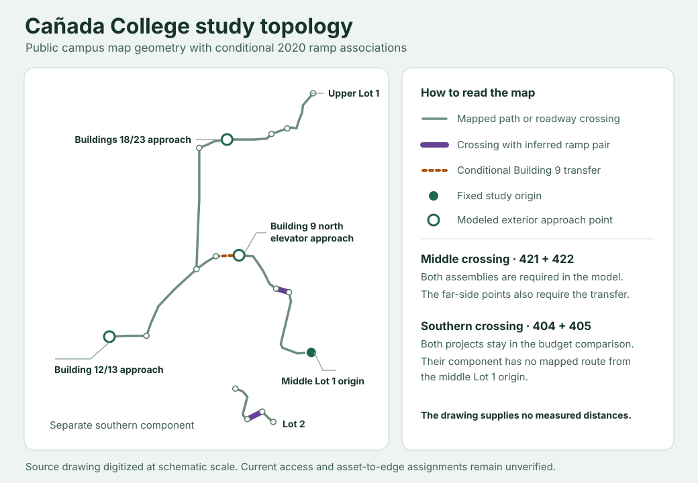

# Cañada College curb-ramp planning study

A historical-cost planning example using the public campus map. When the model assumes the ramp locations, a usable Building 9 elevator transfer, and that other barriers and unknown conditions are addressed outside the ramp budget, the exact planner connects **3 modeled exterior points** from middle Lot 1 with **$10,500** in published 2020 ramp estimates. The conservative scenario connects **zero**.

**The result applies to one origin and three exterior approach points.** The southern 404/405 pair has no mapped connection to that origin or those targets. Both southern projects remain in the eligible pool and in the $23,500 nominal cost denominator. This limits what the comparison can say about campus-wide performance.

## What changes under the assumptions

| Scenario | Exact maximum at the tested nominal budgets |
| --- | ---: |
| Unresolved access and known non-ramp conditions retained | 0 |
| Other conditions assumed resolved, ramp placement unconfirmed | 0 |
| Ramp placement assumed, Building 9 transfer excluded | 1 |
| Ramp placement and Building 9 transfer assumed | 3 |

The favorable scenarios assume that other barriers and unknown conditions on the schematic paths are resolved outside this budget. These include sidewalk and approach defects, roadway conditions, widths, slopes, and assessment coverage. The Building 9 transfer and usable landings require their own explicit assumption. None of this work is observed.

The transfer scenario’s least-cost plan for its maximum uses ramp 421 and ramp 422 and reaches Building 9 north elevator approach, Building 12/13 approach, and Path beside Buildings 18/23. Its first tested budget at that outcome is $11,750. Removing either middle ramp from the complete four-project selection removes all three modeled connections in this scenario.

## Same-budget results

Each cell is **newly connected exterior points / historical ramp spend** for the scenario with the transfer assumed. All strategies used the same fixed origin, targets, costs, and budget at each comparison.

| Nominal budget | Exact | Cheapest first | Single-repair greedy | Crossing-bundle greedy |
| ---: | ---: | ---: | ---: | ---: |
| $0 | 0 / $0 | 0 / $0 | 0 / $0 | 0 / $0 |
| $5,875 | 0 / $0 | 0 / $3,500 | 0 / $3,500 | 0 / $0 |
| $11,750 | 3 / $10,500 | 0 / $10,000 | 3 / $10,500 | 3 / $10,500 |
| $17,625 | 3 / $10,500 | 0 / $16,500 | 3 / $17,000 | 3 / $10,500 |
| $23,500 | 3 / $10,500 | 3 / $23,500 | 3 / $23,500 | 3 / $23,500 |

Wins count additional modeled exterior points at equal budgets. Ties may differ in spend. The nominal tier covers five budgets in each of four scenarios. The cost stress tier uses the three intermediate budgets and changes all costs together or one project at a time by −25% or +25%. These perturbations test sensitivity and supply no current quotes.

| Exact versus | Nominal wins / ties / losses (20 cases) | Stress wins / ties / losses (120 cases) |
| --- | ---: | ---: |
| Cheapest first | 4 / 16 / 0 | 26 / 94 / 0 |
| Single-repair greedy | 0 / 20 / 0 | 0 / 120 / 0 |
| Crossing-bundle greedy | 0 / 20 / 0 | 0 / 120 / 0 |

Both greedy baselines tie exact on endpoint count in all tested cases. The crossing-bundle baseline can buy either crossing as a complete work package. A published-priority comparator is unavailable because ramp 404’s priority is unresolved.

## Sources and scope

The campus map supports the schematic paths and approximate crossing locations. Attaching the 2020 ramp IDs to those crossings is a plausible historical alignment. The map does not establish operational elevators, door or landing continuity, or access today. The indoor library link is excluded. Published witness paths list their nodes and edges without measured lengths.

| Published 2020 assembly | Estimate | Conditional placement |
| --- | ---: | --- |
| ramp 404 | $6,500 | Disconnected southern crossing |
| ramp 405 | $6,500 | Disconnected southern crossing |
| ramp 421 | $7,000 | Middle Lot 1 crossing |
| ramp 422 | $3,500 | Middle Lot 1 crossing |

These four figures cover curb ramps and their replacement assemblies only. Other barriers, maintenance, crossings, and complete routes have no estimated totals here. The original historical inventory remains inventory-only. This study measures modeled connections under assumptions and makes no claim about observed benefit, legal compliance, or actual accessibility.

- [2026 campus map](https://www.canadacollege.edu/about/docs/canada-map-directory.pdf) and [Building 9 design record](https://smccd.edu/facilities/projects/can/canbld9llrc.php)
- [November 2020 district accessibility report](https://smccd.edu/ada2020/19029%20SMCCCD%20ADA%20Self-Evaluation%20and%20Transition%20Plan%20FINAL%20Nov2020%20sm.pdf) and [transcribed ramp estimates](../../../research/curb/canada-2020/projects.json)
- [Topology evidence and exclusions](../../../docs/research/canada-case/map-topology.json) and [frozen study policy](../../../research/curb/canada-map-study/study-spec.json)

## Reproduce

Run from the repository root with the installed Node dependencies and Python.

~~~sh
node --import tsx scripts/curb/canada-map-study/generate.ts
node --import tsx scripts/curb/canada-map-study/generate.ts --check
python scripts/curb/canada-map-study/verify.py --check
~~~

The frozen inputs are SHA-256 checked. [Results JSON](results.json) contains all sixteen selections for each scenario and cost variant, selected-plan omissions, singletons, nondominated alternatives, and path witnesses. [Results CSV](results.csv) lists the budget/strategy outcomes. [Claims JSON](claims.json) carries the comparison counts and evidence boundaries. [Independent verification](verification.json) checks the results with a separate graph oracle.
